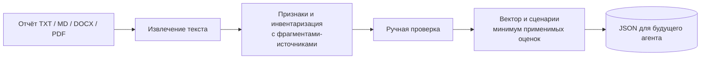

<div align="center">

# 🧭 AD Report Intake

**Локальный модуль: отчёт об ИС → проверенные факты об Active Directory → JSON для агента.**

Извлекает явно указанные сведения из отчёта, сохраняет фрагменты-источники, помогает проверить выводы и считает вектор защитных мер. Модель и внешние API для работы не нужны.


</div>

> В репозитории только вымышленные данные. Загружаемые отчёты и результаты анализа могут содержать сведения об инфраструктуре: храните их локально. Экспорт `*.ad-context.json` исключён из Git.

---

## Как это работает



- **Проверяемые выводы.** Каждому автоматически найденному признаку соответствует строка, абзац или страница исходного отчёта. Противоречия помечаются отдельно.
- **Честные пропуски.** Отсутствие сведений даёт статус «неизвестно» и интервал оценки, а не придуманное значение.
- **Разделение контекста и оценки.** Количество АРМ и удалённых хостов сохраняется как инвентаризация; оно не превращается напрямую в балл защиты.
- **Локальная работа.** Интерфейс доступен только на `127.0.0.1`; сервер не сохраняет загруженный отчёт и не отправляет его во внешние сервисы.
- **Контракт для интеграции.** Функции `analyze()` и `evaluate()` можно вызвать из будущего проекта без веб-интерфейса.

## Быстрый старт

Требуется Python 3.11+. Для TXT, MD и DOCX достаточно стандартной библиотеки. Для PDF с текстовым слоем дополнительно установи PyMuPDF:

```bash
pip install pymupdf
```

В Windows запусти `run.cmd` или выполни:

```powershell
python app.py --serve
```

Открой `http://127.0.0.1:8765/`, загрузи `example_report.txt`, проверь найденные признаки и нажми **Скачать JSON**. Остановить сервер: `Ctrl+C`.

Для обработки без браузера:

```powershell
python app.py --input example_report.txt --out example_report.ad-context.json
```

Тесты:

```powershell
python -m unittest discover -s tests -v
```

## Формат результата

```json
{
  "schema_version": "1.0",
  "source": {"name": "example_report.txt", "sha256": "..."},
  "context": {"inventory": {"workstations": [], "remote_hosts": []}, "authorized_scope": null},
  "observations": {
    "dc_os": {
      "status": "known",
      "value": 0,
      "method": "rule",
      "evidence": [{"locator": "строка 3", "excerpt": "Контроллер домена: Windows Server 2012 R2."}]
    }
  },
  "evaluation": {"vector": {}, "scenarios": {}}
}
```

Это сокращённый пример структуры. Полный результат содержит все признаки, оценки и источники. `authorized_scope` остаётся пустым: разрешённые границы тестирования нельзя выводить из списка узлов.

Оценки `0`, `0.5`, `1` задают состояние мер. Для направления или сценария берётся минимум применимых оценок. При неизвестных признаках выдаётся интервал. Это экспертная модель для выбора следующих вопросов и проверок, а не вероятность взлома. Оценка `1` означает, что мера указана в отчёте или подтверждена вручную; техническую проверку она не заменяет.

## Структура

| Файл | Назначение |
| :--- | :--- |
| `core.py` | чтение файлов, извлечение признаков, оценка и контракт JSON |
| `app.py` | локальный HTTP-интерфейс и CLI |
| `index.html` | форма проверки признаков и экспорт |
| `example_report.txt` | синтетический учебный отчёт |
| `tests/` | офлайн-тесты извлечения и локального API |
| `run.cmd` | быстрый запуск в Windows |

## Ограничения

- Правила извлечения узкие и ориентированы на явные формулировки об AD. Результаты нужно проверять перед передачей агенту.
- PDF без текстового слоя пока не поддерживаются: для сканов нужен OCR.
- Программа не выполняет пентест и не подключается к ИС. Загруженный отчёт считается данными, а не инструкциями для будущего агента.

## Лицензия

MIT — см. [LICENSE](LICENSE).
